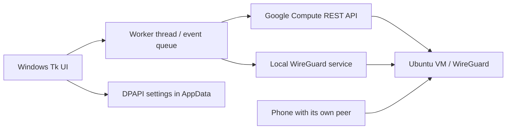

# GCP VPN Manager

A Windows desktop controller for your own Google Compute Engine + WireGuard VPN.
Start a VM when you need it, connect your PC, or leave it running for your phone.
Configure **one server or up to twenty** without editing source code.

**[完整繁體中文部署教學：從 GCP 建立到 Windows 連線](docs/SETUP.zh-TW.md)**

> This is a self-hosted infrastructure tool, not a VPN subscription.
> Google Cloud resources cost money. The project does not provide servers,
> credentials, anonymity guarantees, or a kill-switch beyond WireGuard's behavior.

## Features

- First-run setup: enter project/VM details and import each PC WireGuard `.conf`.
- Persistent settings: Windows DPAPI encryption, no secrets next to the EXE.
- One or many servers; add, edit, and remove saved servers through **Settings**.
- Start VM only, connect PC, disconnect PC while keeping the VM, confirmed shutdown.
- Dynamic external IPv4 refresh while preserving each imported endpoint's port.
- Google ADC login (recommended) or an explicitly imported service-account key.
- Reconnect recovery for stale tunnels, route/DNS changes, and transient cloud reads.
- Separate cloud state and local service state; a refresh failure is not reported
  as a failed action. DNS/TLS reachability is not claimed as a WireGuard handshake.
- Redacted persistent logs with **seven calendar days**, including today, retained.
- Native Windows x64 and x86 builds, automated tests, and GitHub Actions.

## Quick start

1. Follow the [deployment guide](docs/SETUP.zh-TW.md) to create **one** Ubuntu
   24.04 VM, allow its single WireGuard UDP port, and create a PC peer.
2. Install [official WireGuard for Windows](https://www.wireguard.com/install/).
3. Install the [Google Cloud CLI](https://cloud.google.com/sdk/docs/install) and,
   under the same Windows account that runs this app, run:

   ```powershell
   gcloud auth application-default login
   gcloud auth application-default set-quota-project YOUR_PROJECT_ID
   ```

   `gcloud auth login` alone is **not** Application Default Credentials. The
   account must have the permissions listed in the deployment guide.
4. Choose `releases\windows-x64\GcpVpnManager-windows-x64.exe` for 64-bit Windows,
   or `releases\windows-x86\GcpVpnManager-windows-x86.exe` for 32-bit Windows.
   Check the SHA-256 listed in [releases/SHA256SUMS.txt](releases/SHA256SUMS.txt).
5. Run the EXE and approve elevation for WireGuard service management.
6. First launch: enter your project ID, select authentication, enter a display
   name / zone / VM name, and **Import WireGuard .conf**. Click **Save settings**.
   Repeat **Add / update server** only if you want more than one.
7. Select your server and click **Connect this PC**, or **Start VM only** for phone use.

No Python installation is needed to run the bundled EXEs. WireGuard is a separate
prerequisite and is not redistributed. The EXEs are unsigned; the manifest asks
for administrator access but is **not** a code signature. Do not disable Windows
security protections globally. Only run binaries from a source you trust.

### Compatibility

| Platform | Artifact | Scope |
|---|---|---|
| Windows x64 | `releases/windows-x64/` | Native x64 build |
| Windows x86 | `releases/windows-x86/` | Native 32-bit build; also runs under WOW64 |
| Linux / Linux ARM32 / ARM64 | None | Not included in this release |
| Windows ARM | None | Native ARM support not claimed |

Use a supported Windows version with compatible Python 3.13 and WireGuard
runtime requirements. Windows 7 is not supported. x86 binary checks on a 64-bit
host do **not** establish compatibility with every legacy 32-bit Windows machine.
See [release verification scope](releases/README.md).

## How it works



The controller is outside the VM, so it can start a powered-off VM. Reconnecting
first removes **this app's** old local tunnels, briefly uses the ordinary
non-VPN internet connection, starts/reads the VM, renders its current endpoint,
and installs the selected local tunnel. It does not silently disable unrelated
WireGuard tunnels or shut down old cloud VMs when switching servers.

**Disconnect**, **exit**, and **switch server** leave VMs running. Use **Stop VM**
explicitly; this interrupts all devices. Settings are disabled while managed
tunnels exist so removing a saved server cannot strand an unmanaged service.
After installing the app alongside another VPN client, disconnect that client
before use; competing full-tunnel routes are not managed automatically.

### Settings, secrets and logs

Settings and logs are stored per Windows account in `%LOCALAPPDATA%\GcpVpnManager`:

| File | Purpose |
|---|---|
| `settings.dat` | DPAPI-encrypted project, nodes, imported profiles and optional key |
| `gvpn-*.conf` | Rendered private runtime profiles used by installed WireGuard services |
| `logs\vpn-YYYY-MM-DD-PID.log` | Redacted application diagnostic records |

The directory ACL allows the current Windows user and SYSTEM. Runtime profiles
must remain available across WireGuard service restarts and are **not encrypted
by this app**; their protection is the directory ACL. After successful disconnect
and confirmed service removal, the generated files are removed (the imported
profiles remain in encrypted settings). Administrators and malware
running as your user can still access secrets. DPAPI is not a substitute for a
secure Windows account or disk encryption.

Import files are validated: one interface/peer, well-formed keys and addresses,
and no command hooks. ADC is managed by Google's SDK separately. Service-account
keys are only accepted with Google's official token endpoint. Keys/profiles are
never deliberately logged; known key/token patterns are redacted from tracebacks.
Logs can still include project/instance names, public IPs and paths.

**Open logs** opens the private log directory. Old app-named logs are deleted at
startup and hourly while running. When the app is closed, cleanup waits until
its next launch; no scheduled background task is installed.

Settings survive restarts and EXE upgrades under the **same Windows account**.
They are not portable across Windows accounts/machines. Keep your original
profiles/key in a secure backup; do not upload them here. Do not run elevation
using a different administrator account unless you intend to configure that
account separately.

## Build from source

Install Python 3.13 **with Tcl/Tk**. The interpreter's architecture determines
the EXE architecture; PyInstaller is not a cross-compiler.

```powershell
python -m venv .venv
.\.venv\Scripts\python.exe -m pip install -r requirements-build.txt
.\scripts\build.ps1 -Architecture x64 -Python .\.venv\Scripts\python.exe
```

For x86, install 32-bit Python and create a **separate** environment:

```powershell
& 'C:\Path\To\Python-x86\python.exe' -m venv .venv-x86
.\.venv-x86\Scripts\python.exe -m pip install -r requirements-build.txt
.\scripts\build.ps1 -Architecture x86 -Python .\.venv-x86\Scripts\python.exe
```

To run source from an elevated terminal:

```powershell
.\.venv\Scripts\python.exe src\app.py
```

The build script runs tests, checks interpreter architecture, builds the EXE,
and verifies the PE machine type, GUI subsystem, admin manifest and bundled
modules. Tests use fake cloud responses; they do **not** require keys, start
VMs, or change real VPN services.

GitHub Actions repeats both native builds on Windows and checks the server
scripts on Linux. Download its `windows-x64` / `windows-x86` workflow artifacts.
It does not publish a GitHub Release automatically or require GCP credentials.
Direct dependencies are pinned; CI dependency inventories record the resolved
transitive versions. Builds are not claimed to be byte-for-byte reproducible.

## Repository layout

```text
src/                 UI, validated settings, cloud REST, Windows service adapter
tests/               Unit/regression tests and real local DPAPI round-trip
server/              Reviewable Ubuntu WireGuard setup / peer scripts
scripts/             Build and PE verification tools
docs/                End-to-end GCP and WireGuard deployment guide
releases/            Windows binaries, hashes, build inventories and scope
.github/workflows/   CI for both Windows architectures and shell scripts
```

## Limitations / responsible operation

- One GCP project per configuration; 1-20 zonal instances with external IPv4.
- Service activation and Google TLS reachability are not VPN-handshake, egress-IP
  or all-sites connectivity verification.
- No automatic idle shutdown: phone usage must not be inferred from this PC.
- No mobile control website. Use Google Cloud Console on the phone to start the
  VM when the PC is off, then enable the phone's separate WireGuard profile.
- Ephemeral external IP changes are updated for the PC, not automatically for
  phones. Reserve a static address (billable) or update phone endpoints.
- Server scripts target a **fresh Ubuntu 24.04** VM, IPv4 NAT, trusted peers and
  the `10.77.0.0/24` tunnel subnet. They are not a generic migration script.
- No project-wide organization-policy changes are needed or performed.

## License

Application source is released under [MIT](LICENSE). Bundled runtimes/libraries
have separate licenses; see [THIRD_PARTY_NOTICES.md](THIRD_PARTY_NOTICES.md).
